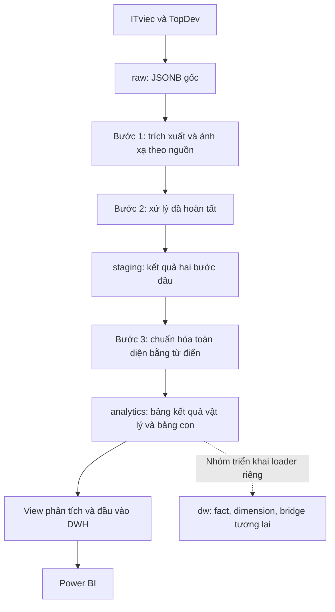
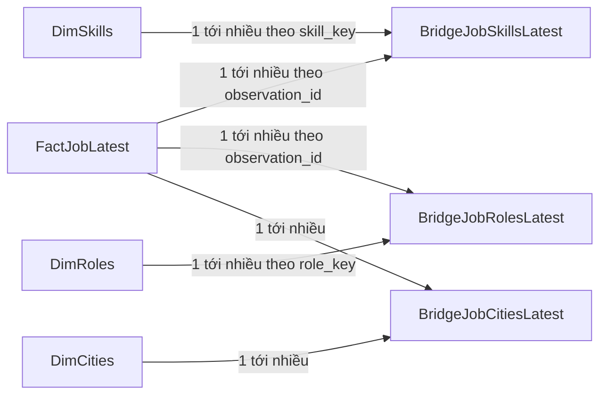

# Luồng staging → analytics vật lý → đầu vào DWH

Cập nhật **01/11/2026 — phạm vi chỉ bước 3**. Tài liệu này thay thế thiết kế analytics chỉ gồm view ngày 30/10. Hợp đồng vẫn **1.2**, 30 trường chung, không `requirement_type` ở kỹ năng, học vấn hoặc ngoại ngữ.

## 1 Ranh giới ba bước xử lý



- `raw` giữ nguyên dữ liệu gốc.
- **Phần 1 và 2 đã làm xong, giữ nguyên mã và quy tắc hiện có.** Bước 3 nhận dữ liệu staging do hai phần này tạo; không chỉnh, tháo hoặc chuyển quy tắc của chúng. Nếu đầu vào đã chuẩn thì bước 3 giữ kết quả tương đương, không làm lại raw.
- Bước 3 là lệnh riêng: `tools/configure_analytics.py`. Lệnh đọc staging đủ gate, gọi `analytics_transform.transform_record`, rồi ghi **bảng thật trong analytics**. Không ghi ngược raw/staging, không tạo schema normalize/normalized.
- Các view fact/bridge/percentage nay đọc bảng analytics, không đọc staging trực tiếp. Thay đổi staging chỉ xuất hiện ở analytics sau lần load thành công tiếp theo.
- Các bản ghi staging đã chuẩn hóa từ những lần chạy trước được giữ nguyên. Đợt sửa này không replay raw để khôi phục giả định một phiên bản staging cũ.
- `topdev_normalize_data` và `itviec_normalize_data` là thư mục mã Python, không phải schema database.

Ví dụ fixture đầu vào staging còn alias `cpp`, `Cplus`, `C/C++`, `English`: bước 3 đưa về hai skill `C++`, `C` và chuyển English sang bảng ngoại ngữ. Đây là fixture kiểm thử đầu vào còn cần chuẩn hóa, không phải khẳng định phần 1/2 hiện luôn xuất các alias này. Staging không bị sửa bởi bước 3.

### Mốc nguồn đối chiếu

GitHub main gốc `feff047` và nhánh TopDev `0f90fce` đã có crawl, ánh xạ/kiểm định 30 trường và ghi staging. Phần 1/2 trong đợt này được giữ nguyên **so với 884b1dc**, không phải khôi phục toàn bộ về hai commit gốc. Các sửa đổi 29–30/10 trước đó (kể cả lời gọi `clean_record → standardize_record` trong normalizer) vẫn còn ở mốc 884b1dc. Loader bước 3 mới chỉ ghi analytics; đợt này không tự gỡ hoặc replay các quy tắc upstream đã có. Phân biệt này tránh hiểu nhầm rằng toàn bộ code upstream hiện trùng bản GitHub đầu tiên.

## 2 Đối tượng bàn giao cho phần load DWH

| Đối tượng | Loại | Ý nghĩa |
|---|---|---|
| analytics.job_observations | TABLE | Một job trong một lần crawl; giữ observation_id, job_id, crawl_run_id và trường đơn |
| analytics.job_skills, job_roles, job_cities… | TABLE | Một giá trị trên mỗi dòng; FK nội bộ analytics, không FK sang staging |
| analytics.job_education_requirements, job_education_majors | TABLE | Học vấn và chuyên ngành tách riêng, giữ ngữ cảnh liên kết |
| analytics.load_state | TABLE | Hash đầu vào/đầu ra/transform và thời điểm load của từng observation |
| analytics.jobs, analytics.dwh_ready_jobs | VIEW | Đủ 30 trường để kiểm tra/trao đổi; danh sách JSON được dựng từ bảng con |
| analytics.fact_job_observations, fact_job_latest | VIEW | Lịch sử và quan sát mới nhất trên dữ liệu analytics đã lưu |
| analytics.dim_skills, bridge_job_skills_latest | VIEW | Danh mục skill và liên kết nguyên tử dùng cho phân tích |
| analytics.role_skill_demand_latest | VIEW | Số job và tỷ lệ nhắc tới skill theo role |

**Đầu vào vật lý cho DWH nằm ở `analytics.job_observations` và các bảng con**, không còn lấy đầu ra bước 3 từ staging. View 30 trường chỉ là cách biểu diễn tương thích; không phải lý do để nhét mảng vào cột fact DW.

Khóa nghiệp vụ một quan sát: **(job_id, crawl_run_id)**. Không chỉ dùng job_id vì sẽ mất lịch sử crawl. observation_id giữ lineage từ staging nhưng analytics không phụ thuộc FK vào staging.

Bản local sau khi áp dụng: 20 quan sát, 13 job phân biệt; đó là mẫu hiện có, không phải quy mô toàn thị trường. `dw` vẫn là phần nhóm sẽ triển khai riêng, không được tạo trong đợt này.

## 3 Lệnh chạy và cách load lần đầu/lần sau

Chạy từ thư mục gốc project, với PostgreSQL đã có contract 1.2 và cấu hình kết nối qua `DATABASE_URL` hoặc `PGHOST/PGPORT/PGDATABASE/PGUSER/PGPASSWORD`. Không ghi thông tin đăng nhập vào repo.

```bash
# Xem trước, không ghi database
python tools/configure_analytics.py --out reports/analytics-physical/check

# Lần đầu: tạo cấu trúc analytics và nạp tất cả batch staging hợp lệ
python tools/configure_analytics.py --apply --out reports/analytics-physical/load-01

# Nạp batch mới, dùng một thư mục bằng chứng mới
python tools/configure_analytics.py --apply --crawl-run-id CRAWL_RUN_ID --out reports/analytics-physical/load-02

# Kiểm tra lại toàn bộ batch; dữ liệu/rule không đổi sẽ không ghi
python tools/configure_analytics.py --apply --out reports/analytics-physical/recheck-01
```

`tools/standardize_warehouse.py` là tên lệnh tương thích, gọi cùng loader. `main_topdev.py` / `main_itviec.py` và mã xử lý phần 1/2 được giữ nguyên. Lệnh mới chỉ xử lý bước 3 trên staging đã có; người phụ trách phần 1/2 tiếp tục vận hành chúng như trước. `tools/clean_staging.py` là công cụ replay/sửa lớp staging, **không phải lệnh bước 3**; không chạy nó để chuyển dữ liệu sang analytics.

| Trường hợp | Hành vi loader analytics |
|---|---|
| Lần đầu | Nạp mọi quan sát đủ gate và cấu hình serving views |
| Chạy lại cùng batch, cùng dữ liệu/rule | written_observations=0; không thay loaded_at, không ghi lại bảng con |
| Batch mới | Chỉ nạp quan sát mới; giữ lịch sử cũ |
| Cùng khóa quan sát có thay đổi hợp lệ | Chỉ upsert quan sát đó và thay bảng con của nó trong analytics |
| Từ điển/transform đổi | Tính lại đầu ra analytics cho các quan sát được chọn; không replay raw hoặc ghi staging |
| Batch lỗi hoặc lineage không đầy đủ | Không xuất một phần batch; chỉ định batch lỗi sẽ báo lỗi |
| Lỗi giữa lúc ghi | Rollback toàn bộ transaction |

Loader hiện quét các quan sát staging đủ gate để so hash; **incremental ở phần ghi**, chưa phải CDC hoặc chỉ đọc delta. `--crawl-run-id` giới hạn batch nguồn.

Dữ liệu analytics đã xuất là bản lưu độc lập: staging bị sửa/xóa không tự làm mất bản analytics cũ. Bản xuất cũ được giữ khi batch bị đánh lỗi; cần quy trình thu hồi riêng nếu nhóm muốn rút dữ liệu đã công bố, không tự xóa âm thầm.

### Giao ước cho người làm loader DWH

1. Lần đầu đọc toàn bộ bảng analytics, upsert dimension trước rồi fact/bridge trong transaction.
2. Lần sau đọc các observation mới/đổi theo trạng thái load; upsert bằng (job_id,crawl_run_id), thay bridge chỉ cho quan sát đổi. Chạy lại cùng input không sinh bản ghi trùng.
3. Chỉ ghi trạng thái đã nạp trong DW sau khi commit/đối soát thành công. Không sửa `analytics.load_state` vì bảng đó thuộc bước 3.
4. Nếu dùng loaded_at làm watermark, cần cửa sổ đọc chồng và upsert theo khóa; không lấy MAX(timestamp) rồi giả định đã bắt hết các transaction commit muộn. Đây là giao ước thiết kế, chưa có loader DW trong đợt sửa.

```sql
SELECT count(*) FROM analytics.job_observations;
SELECT count(DISTINCT job_id) FROM analytics.job_observations;
SELECT o.job_id,o.crawl_run_id,s.name,s.category
FROM analytics.job_observations o
JOIN analytics.job_skills s USING(observation_id)
ORDER BY o.job_id,o.crawl_run_id,s.item_order;

SELECT o.job_id,o.crawl_run_id,l.loaded_at,l.source_sha256,l.output_sha256
FROM analytics.job_observations o
JOIN analytics.load_state l USING(observation_id)
ORDER BY l.loaded_at,o.observation_id;
```

## 4 Mô hình Power BI dùng ngay



Mũi tên là hướng lọc đơn vào bridge. Role slicer không tự truyền ngược từ bridge role tới fact rồi sang bridge skill; không bật Both cho tất cả quan hệ.

Cách đơn giản nhất: nạp `analytics.role_skill_demand_latest`, dùng `role_name`, `skill_name`, `jobs_with_skill`, `total_role_jobs`, `job_pct`. Giá trị job_pct là 0–100; không định dạng Percent 0–1 thêm lần nữa. Không SUM tỷ lệ giữa các role/skill.

```sql
SELECT role_name, skill_name, category,
       jobs_with_skill, total_role_jobs, job_pct
FROM analytics.role_skill_demand_latest
ORDER BY role_name, job_pct DESC, skill_name;
```

View tổng hợp tính trên toàn bộ latest đủ gate. Nếu cần tỷ lệ phản ứng với slicer ngày, địa điểm, công ty, nguồn, dùng fact/bridge và measure động. Với tên bảng/quan hệ như sơ đồ:

```dax
Jobs in role =
VAR RoleJobs = VALUES(BridgeJobRolesLatest[observation_id])
RETURN CALCULATE(
    DISTINCTCOUNT(FactJobLatest[job_id]),
    KEEPFILTERS(TREATAS(RoleJobs, FactJobLatest[observation_id]))
)

Jobs with skill in role =
VAR RoleJobs = VALUES(BridgeJobRolesLatest[observation_id])
RETURN CALCULATE(
    DISTINCTCOUNT(BridgeJobSkillsLatest[job_id]),
    KEEPFILTERS(TREATAS(RoleJobs, FactJobLatest[observation_id]))
)

Skill share in role = DIVIDE([Jobs with skill in role], [Jobs in role])
```

Mẫu số giữ cả tin không có skill. Định dạng measure cuối là Percentage. Ví dụ DAX trên xử lý role và skill; slicer thành phố hoặc thuộc tính đa trị khác cần thêm phép lọc TREATAS tương ứng từ bridge đó sang fact. Ngày/nguồn/công ty cần quan hệ trực tiếp phù hợp tới fact. Measures là hướng dẫn cho model đặt đúng tên và quan hệ; chưa nghiệm thu tệp PBIX.

## 5 Kiểm định, khôi phục và giới hạn

- Test bao gồm: lần đầu, lặp không ghi (kể cả xmin/loaded_at), batch mới, sửa một quan sát, lỗi giữa transaction, batch lỗi/lineage thiếu, tỷ lệ có job không skill, rollback và chặn rollback cũ.
- Loader đã được chạy bằng role chỉ có SELECT trên raw/staging; quyền ghi chỉ nằm ở analytics. Kiểm thử này chứng minh bước 3 không cần quyền ghi lớp trước.
- Mỗi lần `--apply` lưu before.snapshot.json, after.snapshot.json, metrics.json ở thư mục --out. Snapshot chứa dữ liệu local, không commit các file này.
- Khôi phục database bằng `python tools/configure_analytics.py --rollback THU_MUC_APPLY`. Lệnh kiểm tra đúng trạng thái sau load; thay đổi phát sinh sau đó sẽ chặn rollback. Chỉ lớp analytics được khôi phục, raw/staging giữ nguyên. Gói bàn giao ROLLBACK.sh còn khôi phục mã nguồn đúng preimage đã lưu.
- Không `DROP ... CASCADE` để xóa consumer của người khác. Đối tượng analytics ngoài danh sách quản lý sẽ được giữ và chặn migration khi cần xem xét.
- Từ điển chưa bao phủ mọi nhãn: giữ giá trị chưa rõ để rà soát, không fuzzy-match hoặc đoán dữ liệu thiếu. Nhãn ghép không nhận diện đủ không bị tự tách bừa.
- Taxonomy skill có category=domain vẫn cần duyệt riêng để phân biệt chuyên môn kỹ thuật/lĩnh vực nghiệp vụ; đợt sửa luồng không tự xác nhận taxonomy này đã hoàn chỉnh.
- `job_pct` là tỷ lệ nhắc đến skill, không phải mức bắt buộc; tổng tỷ lệ các skill có thể vượt 100%. Latest không chứng minh tin vẫn còn tuyển.
- Chưa có PBIX hoặc bảng DW vật lý riêng được nghiệm thu trong đợt sửa.
