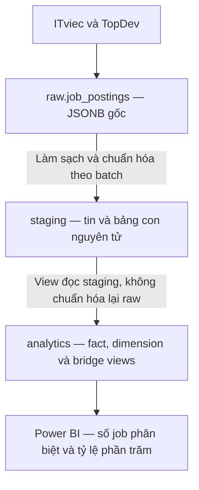
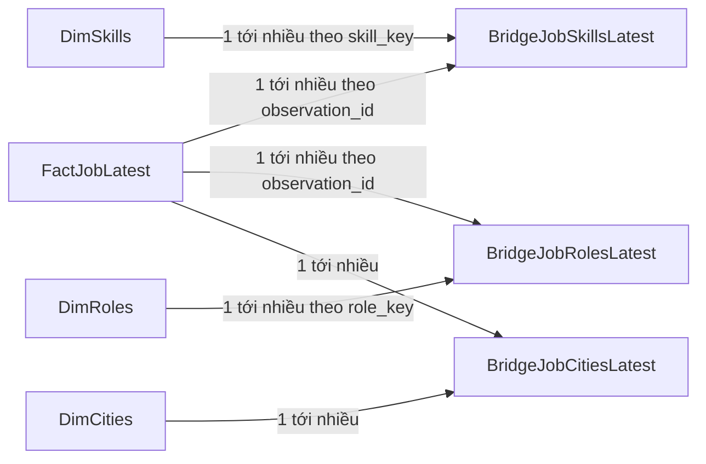
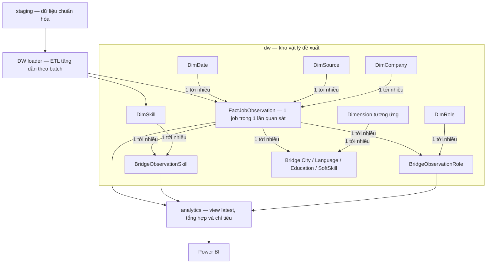

# Kiến trúc DW và analytics cho dữ liệu tuyển dụng

Cập nhật 30/10/2026. Hợp đồng **1.2** giữ 30 trường cấp cao, bỏ `requirement_type` ở kỹ năng, học vấn, ngoại ngữ trong đầu ra chuẩn hóa, bảng staging và mọi view analytics. Báo cáo 29/10 là lịch sử của hợp đồng 1.1.

## 1 Luồng hiện đang triển khai



- **Raw:** giữ bằng chứng gốc; không sửa payload khi bỏ nhãn yêu cầu.
- **Staging:** lưu kết quả chuẩn hóa chung, một observation_id cho một job trong một lần crawl.
- **Analytics:** tên mới của lớp bi, không phải bản copy toàn bộ staging. Alias/reference là bảng vật lý nhỏ, các fact/dimension/bridge phân tích là view.
- **Power BI:** dùng latest để đếm tin phân biệt, history để phân tích lượt quan sát. Latest không chứng minh tin vẫn còn tuyển.

Migration này chỉ đổi schema, bỏ ba cột, cập nhật hợp đồng/view và metadata phiên bản. **Không chạy normalizer trên toàn bộ raw, không xóa/chèn lại bảng con.** Cấu hình lại khi model/từ điển không đổi sẽ không ghi. Tối ưu delta-write cho lệnh replay batch hiện có là hạng mục khác; đợt này không tự nhận đã tối ưu mọi writer.

## 2 Các đối tượng dùng ngay

| Đối tượng | Một dòng là | Hiện có |
|---|---|---:|
| staging.job_observations | Một job trong một lần crawl | 20 |
| analytics.fact_job_observations | Một quan sát đủ gate | 20 |
| analytics.fact_job_latest | Quan sát đủ gate mới nhất của một job_id | 13 |
| analytics.dim_skills | Một tên kỹ năng chuẩn | Theo từ điển và nhãn đơn đang gặp |
| analytics.bridge_job_skills_latest | Một job latest và một skill | 51 |
| analytics.bridge_job_attributes | Một observation, loại thuộc tính, giá trị và ngữ cảnh học vấn | 178 |
| analytics.role_skill_demand_latest | Một role–skill với số tin và % | Tổng hợp latest |
| analytics.skill_demand_latest | Một skill với số tin và % toàn bộ | Tổng hợp latest |

Cột `domain` trong bridge dùng chung nghĩa là **loại thuộc tính** (`skill`, `role`, `city`...), không phải lĩnh vực nghiệp vụ như ngân hàng. Taxonomy skill cũ có nhóm `domain` còn cần duyệt riêng; migration này không tự phân loại lại chúng.

## 3 Ví dụ dữ liệu nguyên tử

Ví dụ minh họa, không phải số liệu thị trường:

**FactJobLatest**

| observation_id | job_id | title |
|---:|---|---|
| 101 | topdev:A | Backend Developer |
| 102 | itviec:B | Backend Developer |

**DimSkill**

| skill_key | skill_name | category |
|---|---|---|
| skill:java | Java | programming_languages |
| skill:docker | Docker | cloud_devops |

**BridgeJobSkill**

| observation_id | job_id | skill_key |
|---:|---|---|
| 101 | topdev:A | skill:java |
| 101 | topdev:A | skill:docker |
| 102 | itviec:B | skill:java |

Hai job cùng thuộc Backend: Java = 2/2 = 100%; Docker = 1/2 = 50%. Tổng 150% vẫn đúng vì một tin có nhiều skill. Mỗi job chỉ đếm một lần mỗi skill, không đếm lặp lịch sử crawl. Đây là tỷ lệ **nhắc đến kỹ năng**, không phải tỷ lệ yêu cầu bắt buộc.

## 4 Mô hình Power BI dùng ngay



Mũi tên là hướng lọc đơn vào bridge. Role slicer không tự truyền ngược từ bridge role tới fact rồi sang bridge skill; không bật Both cho tất cả quan hệ.

Cách đơn giản nhất: nạp `analytics.role_skill_demand_latest`, dùng `role_name`, `skill_name`, `jobs_with_skill`, `total_role_jobs`, `job_pct`. Giá trị job_pct là 0–100; không định dạng Percent 0–1 thêm lần nữa. Không SUM tỷ lệ giữa các role/skill.

```sql
SELECT role_name, skill_name, category,
       jobs_with_skill, total_role_jobs, job_pct
FROM analytics.role_skill_demand_latest
ORDER BY role_name, job_pct DESC, skill_name;
```

View tổng hợp tính trên toàn bộ latest đủ gate. Nếu cần tỷ lệ phản ứng với slicer ngày, địa điểm, công ty, nguồn, dùng fact/bridge và measure động. Với tên bảng/quan hệ như sơ đồ:

```dax
Jobs in role =
VAR RoleJobs = VALUES(BridgeJobRolesLatest[observation_id])
RETURN CALCULATE(
    DISTINCTCOUNT(FactJobLatest[job_id]),
    KEEPFILTERS(TREATAS(RoleJobs, FactJobLatest[observation_id]))
)

Jobs with skill in role =
VAR RoleJobs = VALUES(BridgeJobRolesLatest[observation_id])
RETURN CALCULATE(
    DISTINCTCOUNT(BridgeJobSkillsLatest[job_id]),
    KEEPFILTERS(TREATAS(RoleJobs, FactJobLatest[observation_id]))
)

Skill share in role = DIVIDE([Jobs with skill in role], [Jobs in role])
```

Mẫu số giữ cả tin không có skill. Định dạng measure cuối là Percentage. Ví dụ DAX trên xử lý role và skill; slicer thành phố hoặc thuộc tính đa trị khác cần thêm phép lọc TREATAS tương ứng từ bridge đó sang fact. Ngày/nguồn/công ty cần quan hệ trực tiếp phù hợp tới fact. Measures là hướng dẫn cho model đặt đúng tên và quan hệ; chưa nghiệm thu tệp PBIX.

## 5 DW vật lý đề xuất khi nhóm triển khai bước tiếp

**Sơ đồ dưới là thiết kế đề xuất; đợt này chưa tạo schema dw hoặc nạp các bảng DW vật lý.**



- Dimension có surrogate key do DW quản lý và business key ổn định. Ví dụ Java chỉ có một dòng trong DimSkill; bridge nối nhiều quan sát tới nó.
- Fact giữ job_id, crawl_run_id, ngày quan sát và các số lương/kinh nghiệm có bằng chứng. Unique business key ngăn nạp trùng một quan sát.
- Không nhét danh sách kỹ năng vào ô fact, không nối chéo tất cả bridge thành bảng đếm dòng.
- Loader lưu watermark/batch, lookup/upsert dimension trước, rồi nạp fact/bridge trong transaction. Batch không đổi không nạp lại; quan sát mới ở lần crawl mới vẫn có thể là lịch sử cần giữ.
- Chốt SCD cho công ty/thuộc tính cần lịch sử theo nghiệp vụ, không tự gộp pháp nhân tên gần giống.
- Khi DW đối soát xong, đổi nguồn view analytics từ staging sang DW. Power BI tiếp tục đọc analytics.

## 6 Vận hành và tương thích

Kết nối cấu hình bên ngoài bằng DATABASE_URL hoặc PG*. Chạy từ thư mục dự án:

```powershell
python -m unittest discover -s tests -v
python tools/configure_analytics.py --out reports/analytics-next/check
python tools/configure_analytics.py --apply --out reports/analytics-next/applied
python tools/configure_analytics.py --rollback reports/analytics-next/applied
```

Mặc định chỉ kiểm tra, không ghi. Mỗi apply dùng thư mục mới. Nếu cả bi và analytics tồn tại thì dừng, không tự nhập hai thiết kế. View ngoài lớp quản lý có dependency sẽ chặn migration, không DROP CASCADE. Rollback có kiểm tra snapshot chống ghi đè cập nhật mới.

DB mới dùng các schema SQL 1.2. DB 1.1 đang chạy cần migration trước normalizer 1.2. Đây là breaking change ở cấu trúc lồng; consumer cũ đọc requirement_type phải cập nhật. Snapshot 29/10 cần script cũ trong bản lưu, không dùng lẫn với snapshot mới.

Các parser nội bộ còn dùng ngữ cảnh bắt buộc/ưu tiên để xử lý phủ định và bằng chứng kinh nghiệm; nhãn tạm đó bị loại ở ranh giới đầu ra, không xuất sang staging/analytics.

## 7 Giới hạn dữ liệu

Mẫu thực tế chỉ có 20 lượt TopDev của 13 tin, chưa có ITviec thực trong DB. 7/13 tin có dấu hiệu ngoài IT theo heuristic cần duyệt. Dữ liệu thiếu giữ NULL; không diễn giải tỷ lệ mẫu nhỏ thành tỷ lệ thị trường. Đổi schema và bỏ nhãn không tự sửa vấn đề phân loại domain nghiệp vụ.

## 8 Tài liệu phương pháp

- [Microsoft Learn — Star schema](https://learn.microsoft.com/en-us/power-bi/guidance/star-schema)
- [Microsoft Learn — Many-to-many relationships](https://learn.microsoft.com/en-us/power-bi/guidance/relationships-many-to-many)
- [Microsoft Learn — TREATAS](https://learn.microsoft.com/en-us/dax/treatas-function-dax)
