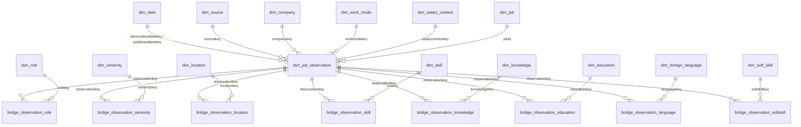

# TÀI LIỆU THIẾT KẾ DWH & MAPPING DIMENSION (NGƯỜI 1)

> **Dự án:** IT Job Market Data Warehouse  
> **Hệ quản trị CSDL:** PostgreSQL 17  
> **Schema đích:** `dwh`  
> **Phụ trách:** Người 1 — Thiết kế DWH và tạo Dimension  

---

## 1. Danh sách 14 Dimension & Phân loại SCD

| STT | Tên Bảng Dimension | Mô tả nghiệp vụ | Khóa chính (Surrogate) | Natural Key / Ràng buộc UNIQUE | Phân loại SCD |
| :-: | :--- | :--- | :--- | :--- | :-: |
| 1 | `dim_date` | Chiều thời gian (quan sát, đăng tin) | `datekey` (YYYYMMDD) | `fulldate` | **SCD Type 0** (Cố định) |
| 2 | `dim_source` | Nguồn dữ liệu (ITviec, TopDev, ...) | `sourcekey` (Identity) | `sourcecode` | **SCD Type 1** |
| 3 | `dim_job` | Thông tin tin tuyển dụng (title, mô tả, link) | `jobkey` (Identity) | `(jobid, iscurrent=TRUE)` | **SCD Type 2** (Lịch sử) |
| 4 | `dim_company` | Công ty tuyển dụng, quy mô, ngành nghề | `companykey` (Identity) | `canonicalcompanyname` | **SCD Type 1** |
| 5 | `dim_work_mode` | Hình thức làm việc (onsite, remote, hybrid) | `workmodekey` (Identity) | `workmodecode` | **SCD Type 1** |
| 6 | `dim_salary_context`| Ngữ cảnh tiền tệ, chu kỳ, tính chất lương | `salarycontextkey` (Identity)| `(currency, period, basis, status)`| **SCD Type 1** |
| 7 | `dim_role` | Vai trò công việc chuẩn hóa | `rolekey` (Identity) | `canonicalrole` | **SCD Type 1** |
| 8 | `dim_seniority` | Cấp bậc / trình độ kinh nghiệm | `senioritykey` (Identity) | `senioritycode` | **SCD Type 1** |
| 9 | `dim_location` | Địa điểm làm việc chuẩn hóa | `locationkey` (Identity) | `canonicalcity` | **SCD Type 1** |
| 10 | `dim_skill` | Kỹ năng công nghệ & danh mục | `skillkey` (Identity) | `(canonicalskill, category)` | **SCD Type 1** |
| 11 | `dim_knowledge` | Kiến thức chuyên môn yêu cầu | `knowledgekey` (Identity) | `canonicalknowledge` | **SCD Type 1** |
| 12 | `dim_education` | Trình độ học vấn & chuyên ngành | `educationkey` (Identity) | `(degree, major)` | **SCD Type 1** |
| 13 | `dim_foreign_language`| Ngoại ngữ yêu cầu | `languagekey` (Identity) | `canonicallanguage` | **SCD Type 1** |
| 14 | `dim_soft_skill` | Kỹ năng mềm | `softskillkey` (Identity) | `canonicalsoftskill` | **SCD Type 1** |

---

## 2. Sơ đồ Star Schema (Quan hệ giữa Dimensions và Fact)

---

## 3. Bảng Mapping từ Nguồn Staging sang DWH Dimensions

| Bảng nguồn (Staging) | Cột nguồn (Staging) | Bảng đích DWH | Cột đích DWH | Quy tắc chuyển đổi / Ánh xạ |
| :--- | :--- | :--- | :--- | :--- |
| `staging.job_observations` | `observed_at` / `published_at` | `dim_date` | `datekey`, `fulldate` | Format `TO_CHAR(ts, 'YYYYMMDD')::INT`. Nếu NULL map sang 0 (Unknown). |
| `staging.job_observations` | `source` | `dim_source` | `sourcecode` | Chuyển chữ thường ('itviec', 'topdev', ...). |
| `staging.job_observations` | `company_name` | `dim_company` | `canonicalcompanyname` | Trim khoảng trắng, nếu NULL gán sang 0 ('Unknown Company'). |
| `staging.job_observations` | `work_mode` | `dim_work_mode` | `workmodecode` | Giữ nguyên enum ('onsite', 'remote', 'hybrid'). Nếu NULL gán 0 ('unknown'). |
| `staging.job_observations` | `salary_currency`, `period`, `basis`, `status` | `dim_salary_context` | `currency`, `period`, `basis`, `status` | Nếu `salary_status` không công bố tiền, `currency/period/basis` gán 'N/A'. |
| `staging.job_observations` | `job_id`, `source_job_id`, `job_url`, `title`, `description` | `dim_job` | `jobid`, `sourcejobid`, `joburl`, `title`, `description` | Áp dụng SCD Type 2: kiểm tra thay đổi `title/description/joburl` để đóng phiên bản cũ và mở phiên bản mới. |
| `staging.job_roles` | `role` | `dim_role` | `canonicalrole` | Trim khoảng trắng, chuẩn hóa chữ hoa/thường. |
| `staging.job_seniority_levels` | `seniority_level` | `dim_seniority`| `senioritycode` | Khớp danh mục ('All levels', 'Internship', 'Fresher', 'Junior', 'Middle', 'Senior', 'Lead', 'Manager', 'Director'). |
| `staging.job_cities` | `city` | `dim_location` | `canonicalcity` | Chuẩn hóa địa danh (Hà Nội, Hồ Chí Minh, Đà Nẵng, ...). |
| `staging.job_skills` | `name`, `category` | `dim_skill` | `canonicalskill`, `category` | `requirement_type` đẩy sang bảng Bridge. `dim_skill` chỉ lưu kỹ năng và nhóm. |
| `staging.job_required_knowledge` | `knowledge` | `dim_knowledge` | `canonicalknowledge` | Trim khoảng trắng. |
| `staging.job_education_requirements` & `staging.job_education_majors` | `degree`, `major` | `dim_education` | `degree`, `major` | Nếu thiếu một trong hai trường, gán giá trị mặc định 'Not Specified'. |
| `staging.job_foreign_languages` | `language` | `dim_foreign_language` | `canonicallanguage` | `level_text`, `requirement_type` đẩy sang Bridge. `dim_foreign_language` lưu tên ngôn ngữ. |
| `staging.job_soft_skills` | `soft_skill` | `dim_soft_skill` | `canonicalsoftskill` | Trim khoảng trắng. |

---

## 4. Hướng dẫn chạy thử nghiệm
1. Chạy `01_create_dimensions.sql` để tạo schema `dwh` và 14 bảng Dimension.
2. Chạy `02_seed_dimensions.sql` để chèn bản ghi Unknown (0), Invalid (-1), lịch `dim_date` (2023–2028) và các danh mục chuẩn.
3. Chạy `03_verify_dimensions.sql` để kiểm tra độ toàn vẹn và số lượng bản ghi.
